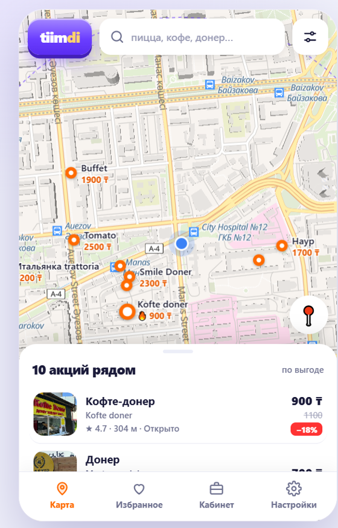
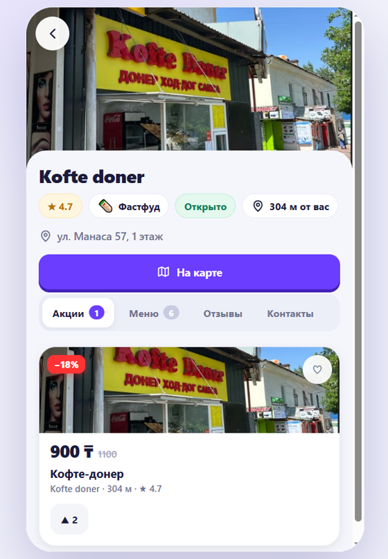
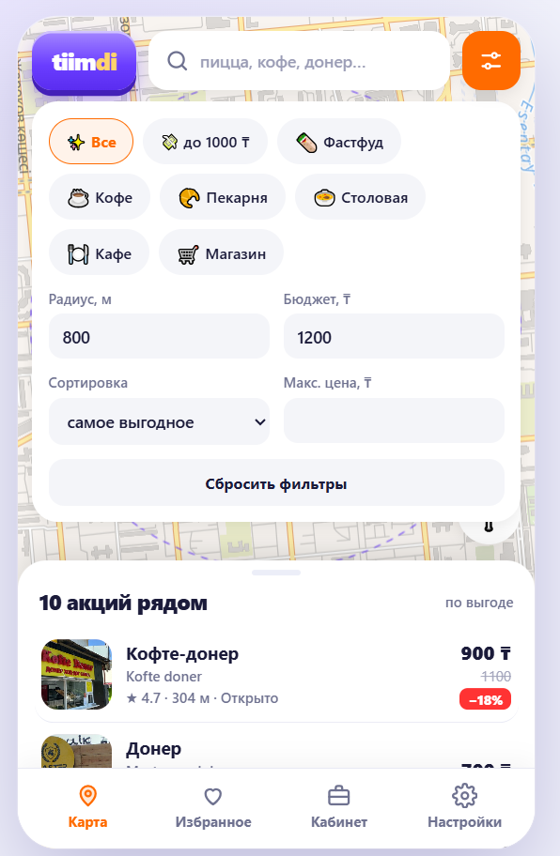
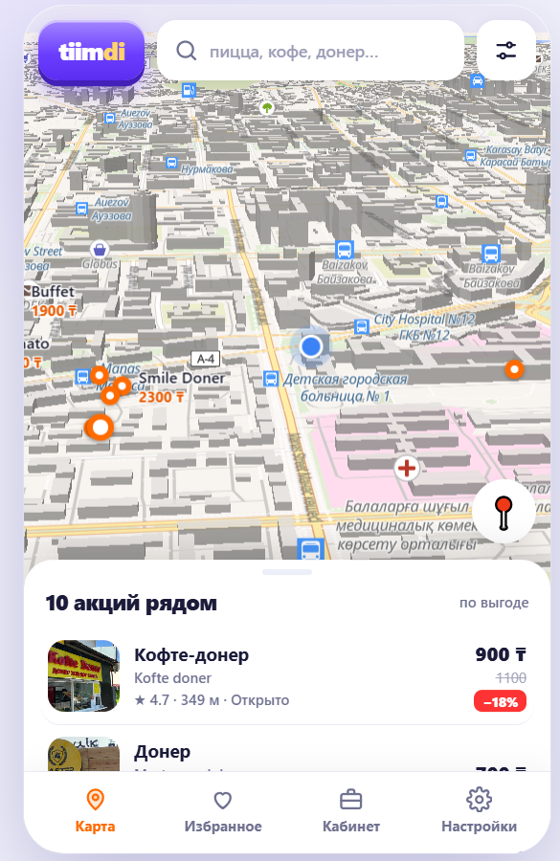
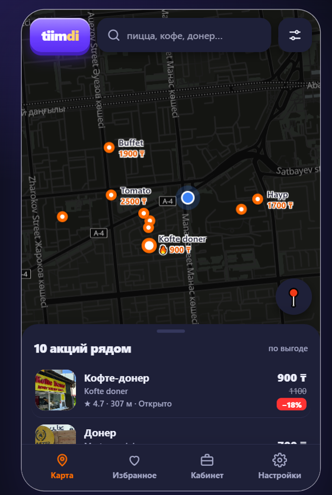
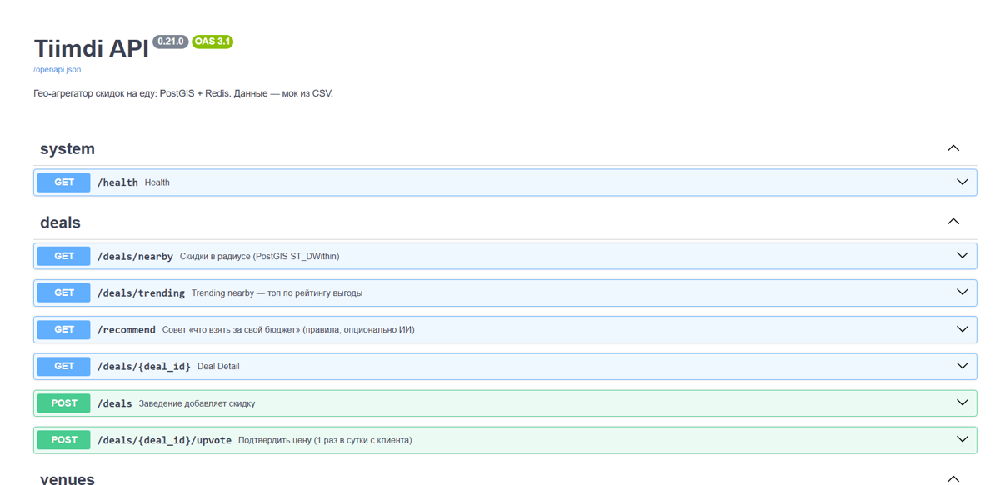

# Tiimdi.app

Geo-aggregator of food deals in Almaty: shows nearby venue promotions on a map, ranks them by "value",
and lets venues add their own deals (cold-start solution). Portfolio project, showcase version.

**Stack:** Python 3.12 · FastAPI · asyncpg (raw SQL) · PostgreSQL 16 + PostGIS · Redis · Docker Compose · Postman · MapLibre GL (vector map, 3D buildings, OpenFreeMap tiles)

**Highlights**
- PostGIS radius search (`ST_DWithin` on a GiST index), ranking formula `0.35·discount + 0.25·cheapness + 0.25·proximity + 0.15·upvotes`
- Redis: versioned response cache, rate limits, one upvote per client per day
- AI layer behind a provider interface (mock / OpenAI-compatible), circuit breaker, daily quota, fallback provider, Pydantic validation of model output; the AI never chooses deals, it only explains the ranked result and reads menu photos
- Single-file frontend: fuzzy search (typos, synonyms, wrong keyboard layout), ru / kk / en, accessibility settings, reviews, saved deals
- Unit tests for ranking, breaker/quota and AI failure scenarios

## Screenshots

<p>
  
  
  
  
</p>
<p>
  
</p>

API documentation (Swagger):



**Showcase version:** the real venue dataset, photos and one-click launchers are intentionally not included, so the repo is for reading, not a turnkey demo. Fill `data/*.csv` with your own data to run it: `docker compose up --build`, then http://localhost:8000 (Swagger: `/docs`).

**Authors:** Bek Kadyrbekov ([@Bew2k](https://github.com/Bew2k)) and Zholdas Bekasyl ([@bekassyl08](https://github.com/bekassyl08)).
**License:** [PolyForm Noncommercial 1.0.0](LICENSE). Viewing and noncommercial use are allowed; commercial use requires the authors' written permission.

## API endpoints

| Method | URL | Description |
|---|---|---|
| GET | `/deals/nearby?lat&lon&radius&category&max_price&sort&limit` | Deals within a radius (PostGIS `ST_DWithin`); sort = best / price / distance / discount |
| GET | `/deals/trending?lat&lon` | "Trending nearby": top deals by value score |
| GET | `/recommend?lat&lon&budget&ai=true` | "What to get for my budget" advice: rule-based, or an AI explanation with `ai=true` (`advice_source` = `ai` or `rules`) |
| GET | `/deals/{id}` · `/venues/nearby` | Deal details · venues within a radius |
| POST | `/venues` | Register a venue |
| POST | `/deals` | Venue adds a deal (10/min per client, Redis) |
| POST | `/deals/{id}/upvote` | Confirm a price (once per day per client, Redis) |
| POST | `/menu/extract` | Menu photo to item list (stores nothing; 5 requests/min, up to 5 MB) |
| POST/GET | `/venues/{id}/menu` | Save / get a venue menu |
| GET/POST | `/venues/{id}/reviews` | Venue reviews (rating 1-5, 5/min limit, profanity filter) |
| POST | `/business-requests` | Venue verification request (3/hour limit) |
| GET | `/health` · `/ai/status` | API, Redis and AI status (provider, failures, daily usage) |

Interactive docs: `/docs` (Swagger UI).

## Request flow: search and recommendation

1. Client calls `GET /deals/nearby (lat, lon, radius)`
2. API checks Redis; on a hit the cached response is returned (`"cached": true`)
3. On a miss, PostGIS runs `ST_DWithin` on a GiST index (R-tree) plus `ST_Distance` in meters
4. The API ranks results: `score = 0.35·discount + 0.25·cheapness + 0.25·proximity + 0.15·upvotes` (`app/ranking.py`)
5. Any write (`POST`) invalidates the cache (the key version in Redis is incremented)

## AI and what happens when it is unavailable

The AI does **not** choose deals: selection and sorting are done by the formula in `app/ranking.py`. The AI only explains the ready top-3 (`/recommend?ai=true`) and reads menu photos (`/menu/extract`). Model output is treated as untrusted: it is validated against a schema (Pydantic), junk items are dropped, and deal titles are marked as data, not instructions, in the prompt.

Configuration: `AI_PROVIDER=mock` (default, no keys needed) or `openai_compat` (Gemini, OpenRouter, Groq, Ollama, ...). See `.env.example`. Connectivity check: `docker compose exec api python -m app.ai [photo.jpg]`.

| Situation | System behavior |
|---|---|
| Out of tokens / rate limit (HTTP 429) | Provider is disabled for the `Retry-After` time (5 min by default); the fallback provider is used if configured, otherwise rule-based advice |
| No answer within `AI_TEXT_TIMEOUT` (8 s) or no connection | Same; disabled for 2 min so following requests do not wait for the timeout |
| Invalid key (401/403) / server error (5xx) | Disabled for 15 min / 1 min; `/ai/status` shows the reason |
| Own `AI_DAILY_LIMIT` ceiling reached | AI is not called until the next day (UTC); the counter lives in Redis |
| Repeated request with the same input | Answered from Redis (advice 10 min, menu 24 h), no tokens spent |
| Redis unavailable | Cache and limits are disabled for 10 s, the API keeps working; the daily limit is counted in process memory |
| AI fully unavailable | `/recommend` returns rule-based advice (`advice_source: "rules"`); menu extraction returns a clear error and manual entry stays possible |

## Tests

```bash
docker compose exec api python -m unittest discover -s tests -v
```
`tests/test_ranking.py`, `test_guard.py`, `test_ai.py`, `test_profanity.py` cover the ranking formula, the circuit breaker, the daily quota, all AI failure scenarios (no network, no keys needed) and the review filter.
Postman: import `postman/tiimdi.postman_collection.json`, then Collection Runner → Run (`base_url` = `http://localhost:8000`; request #19 with a photo is run manually).

## Interface

- Tabs: Map, Nearby (cards), Saved (finished deals turn grey and disappear after 3 days), Studio (venue roles only), Settings (profile, levels, achievements).
- Venue page with tabs: Deals, Menu, Reviews, Contacts; reviews can be left by users.
- Search with autocorrection: typos, synonyms, wrong keyboard layout.
- Settings: language (Russian, Kazakh, English), text size, inverted colors, grayscale mode, reduced motion, light/dark/auto theme.
- Map: flat from afar, 3D buildings on zoom; bounded to Almaty and its surroundings.
- First launch: role selection (student / school student / user / venue); moderator and admin roles cannot be selected. The `?debug` URL parameter enables role switching for development.
- Product decisions and roles: `docs/PRODUCT.md`.

## Structure

```
app/        main.py (API) · ai.py (AI providers) · guard.py (circuit breaker, daily quota) · cache.py (Redis)
            db.py (PostGIS, CSV seeding) · ranking.py (formula) · config.py · schema.sql
static/     index.html (the whole frontend in one file)
data/       venues.csv, deals.csv, menu.csv (headers only)      tests/   unittest      postman/   request collection
```

## Security and limitations

DB credentials in `docker-compose.yml` and CORS `*` are meant for local development and must be changed before any public deployment.

- Most of the UI is in three languages; the studio (venue dashboard) and some dialogs are Russian only.
- Venue photos: the `venues.photo_url` column exists, uploading is not implemented yet (a colored cover with an icon is shown without a photo).
- **Login and roles exist only in the UI:** role and points are stored in the browser's `localStorage`, and `POST /deals`, `/venues`, `/venues/{id}/menu` are open to everyone on the server. Server-side auth (JWT, roles) is the next step.
- Points are calculated by the browser, not the server, so they reset when the device changes.
- A venue menu is shown on the venue page but does not affect ranking.
- The DB schema uses `CREATE IF NOT EXISTS` without migrations: after table changes, run `docker compose down -v` (until Alembic is added).
- If Redis is unavailable, the "1 upvote per day" limit does not apply.
- Local Ollama on CPU is slow: set `AI_TIMEOUT=180` and `AI_TEXT_TIMEOUT=30`.

## Roadmap

JWT auth and roles, moderation (the `status` field in `deals` already exists), server-side reputation (Redis sorted set), subscriptions, ML ranking, CI, deployment.
